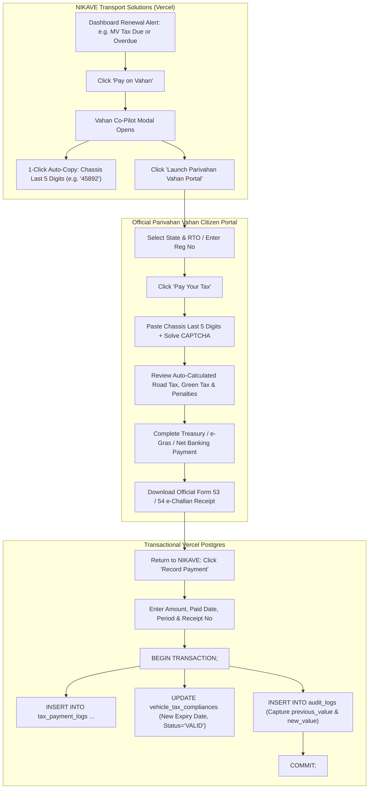
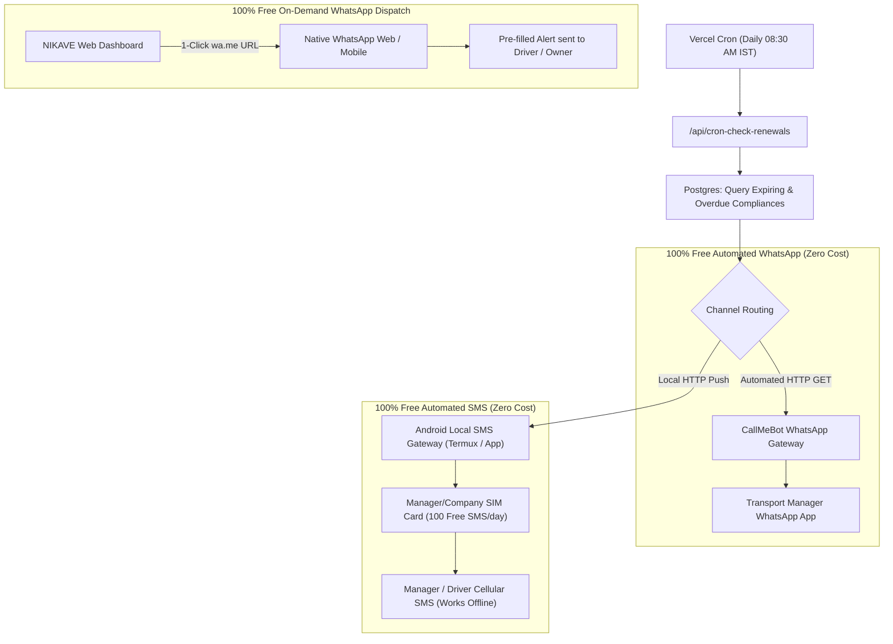

# NIKAVE Transport Solutions — Fleet Compliance & Tax Renewal Tracking System
## Comprehensive Architectural & Implementation Plan (MVP)

---

## 1. Executive Summary & Core Requirements

**NIKAVE Transport Solutions** is a cloud-native Fleet Compliance & Tax Renewal Tracking platform designed for Indian commercial transport operators. It tracks statutory tax and compliance lifecycles, automates renewal alerts via **100% free SMS or WhatsApp**, interfaces smoothly with the **MoRTH Parivahan Vahan** portal, runs on **Vercel** serverless infrastructure, and persists to **Vercel Postgres (Neon)** with complete transactional integrity and comprehensive audit logging.

### Key Architectural Directives
1. **Hosting & Deployment**: 100% hosted on **Vercel** (Vite + React 19 Frontend SPA, Vercel Serverless API Functions, and daily Vercel Cron).
2. **Database Engine**: **Vercel Postgres (Neon Serverless Postgres)** — completely free tier.
3. **Database Rules (Strict)**:
   - **NO Foreign Key Constraints** (`REFERENCES`) in any table. Logical associations are managed purely at the application layer via UUIDs.
   - **UUID Primary Keys**: Every table must have an `id UUID PRIMARY KEY DEFAULT gen_random_uuid()` column.
   - **Standard Timestamps**: Every table must have `created_at TIMESTAMPTZ DEFAULT CURRENT_TIMESTAMP NOT NULL` and `updated_at TIMESTAMPTZ DEFAULT CURRENT_TIMESTAMP NOT NULL`.
   - **Audit Logs Table**: Dedicated `audit_logs` table capturing `previous_value` (JSONB) and `new_value` (JSONB) for all inserts, updates, and deletes.
   - **Transactional Execution**: All data mutations and audit writes run inside atomic SQL transactions (`BEGIN ... COMMIT / ROLLBACK`).
4. **Post-Expiry Thresholds**: Specific post-expiry grace periods, escalation cadences, and penalty rules are stored and tracked individually for each tax type (MV Tax, Green Tax, Insurance, Fitness, Permit, PUCC).
5. **Vehicle Master Rich Profile**: Comprehensive asset metadata including Full Chassis Number, Chassis Last 5 Digits, Registration Date, Engine Number, Owner Details, Hypothecation/Financier, and Commercial Specifications.
6. **Zero-Cost Notifications Only**: Exclude paid services, trials, and complex verification systems (Fast2SMS, Twilio Free Trial, and Meta WhatsApp Cloud API are **completely excluded**). Use **100% Free** automated WhatsApp (CallMeBot), free cellular SMS (Android Gateway / SIM integration), and 1-click WhatsApp direct links (`wa.me`).

---

## 2. MoRTH Parivahan Vahan Portal Workflow

The official tax payment portal is:
**`https://vahan.parivahan.gov.in/vahanservice/vahan/ui/statevalidation/homepage.xhtml`**



### Why the Smart Co-Pilot Approach is Required
- **CAPTCHA & Session Security**: Vahan uses dynamic JavaServer Faces (`.xhtml`), visual CAPTCHAs, and session-locked tokens. Direct headless bot scraping violates government terms of service and triggers immediate IP blacklisting.
- **NIKAVE Co-Pilot Advantage**: Bridges the gap by pre-validating vehicle tax status, auto-copying the exact **Last 5 Digits of the Chassis Number**, directing the manager to the state payment portal, and instantly capturing the payment transaction in a single transactional audit log upon completion.

---

## 3. Database Architecture (Vercel Postgres)

### 3.1 Strict Design Rules
- **No Foreign Keys**: No `REFERENCES` or foreign key constraints exist anywhere in the schema.
- **UUID Everywhere**: Every table uses `id UUID PRIMARY KEY DEFAULT gen_random_uuid()`.
- **Timestamps**: Every table contains `created_at` and `updated_at` with `CURRENT_TIMESTAMP`.
- **Audit Logging**: Every mutation records the pre-image (`previous_value`) and post-image (`new_value`) as JSONB in `audit_logs`.
- **Transactional**: Multi-table updates and audit logging run inside `BEGIN ... COMMIT` blocks.

### 3.2 Schema Definition (DDL)

```sql
-- Enable pgcrypto / uuid-ossp for gen_random_uuid()
CREATE EXTENSION IF NOT EXISTS "pgcrypto";

-- ============================================================================
-- 1. AUDIT LOGS TABLE
-- Records every insert, update, and delete with previous and new JSONB values.
-- ============================================================================
CREATE TABLE audit_logs (
    id UUID PRIMARY KEY DEFAULT gen_random_uuid(),
    entity_name VARCHAR(100) NOT NULL,       -- 'vehicles', 'vehicle_tax_compliances', etc.
    entity_id UUID NOT NULL,                 -- Logical UUID reference (NO foreign key)
    action VARCHAR(20) NOT NULL,             -- 'INSERT', 'UPDATE', 'DELETE'
    previous_value JSONB,                    -- NULL on INSERT
    new_value JSONB,                         -- NULL on DELETE
    performed_by VARCHAR(100) DEFAULT 'system',
    ip_address VARCHAR(45),
    created_at TIMESTAMPTZ DEFAULT CURRENT_TIMESTAMP NOT NULL,
    updated_at TIMESTAMPTZ DEFAULT CURRENT_TIMESTAMP NOT NULL
);

CREATE INDEX idx_audit_logs_entity ON audit_logs(entity_name, entity_id);
CREATE INDEX idx_audit_logs_created_at ON audit_logs(created_at DESC);

-- ============================================================================
-- 2. VEHICLE MASTER TABLE
-- Detailed asset records including engine, full chassis, registration, owner info.
-- ============================================================================
CREATE TABLE vehicles (
    id UUID PRIMARY KEY DEFAULT gen_random_uuid(),
    registration_number VARCHAR(20) NOT NULL,        -- e.g. 'TN-01-AB-1234'
    registration_date DATE NOT NULL,                 -- Date of first registration
    chassis_number VARCHAR(50) NOT NULL,             -- Full 17-digit Chassis / VIN
    chassis_last_5 VARCHAR(5) NOT NULL,              -- Critical 5 digits for Vahan portal
    engine_number VARCHAR(50) NOT NULL,              -- Engine serial number
    vehicle_class VARCHAR(50) NOT NULL,              -- 'HGV', 'Multi-Axle Truck', 'Tipper', 'LCV', 'Bus'
    make_model VARCHAR(100) NOT NULL,                -- e.g. 'Tata Signa 4825.TK', 'Ashok Leyland 2820'
    manufacturing_year INT NOT NULL,                 -- e.g. 2016 (determines Green Tax eligibility)
    manufacturing_month INT,                         -- 1 to 12
    gross_vehicle_weight_kg INT NOT NULL,            -- GVW (e.g. 28000 kg)
    unladen_weight_kg INT,                           -- Tare weight in kg
    seating_capacity INT DEFAULT 2,
    fuel_type VARCHAR(30) DEFAULT 'DIESEL',          -- 'DIESEL', 'CNG', 'ELECTRIC', 'LNG'
    emission_norms VARCHAR(20) DEFAULT 'BS-VI',      -- 'BS-IV', 'BS-VI'
    body_type VARCHAR(50),                           -- 'Open Body', 'Container', 'Tanker', 'Flatbed'
    color VARCHAR(30),
    state VARCHAR(50) NOT NULL,                      -- e.g. 'Tamil Nadu'
    rto_code VARCHAR(20) NOT NULL,                   -- e.g. 'TN-01'
    
    -- Owner Information
    owner_name VARCHAR(150) NOT NULL,                -- Registered owner / company name
    owner_father_or_rep_name VARCHAR(150),
    owner_phone VARCHAR(20) NOT NULL,                -- Contact for WhatsApp / SMS notifications
    owner_email VARCHAR(100),
    owner_address TEXT,
    owner_pan_or_gst VARCHAR(30),
    
    -- Operational & Driver Details
    driver_name VARCHAR(100),
    driver_phone VARCHAR(20),
    driver_license_number VARCHAR(50),
    depot_or_division VARCHAR(100),                  -- e.g. 'Chennai Port Depot'
    
    -- Financial Hypothecation
    is_hypothecated BOOLEAN DEFAULT FALSE,
    financier_name VARCHAR(150),                     -- Bank / NBFC (e.g. 'HDFC Bank Ltd')
    
    status VARCHAR(30) DEFAULT 'ACTIVE',             -- 'ACTIVE', 'MAINTENANCE', 'DECOMMISSIONED'
    notes TEXT,
    
    created_at TIMESTAMPTZ DEFAULT CURRENT_TIMESTAMP NOT NULL,
    updated_at TIMESTAMPTZ DEFAULT CURRENT_TIMESTAMP NOT NULL
);

CREATE UNIQUE INDEX idx_vehicles_reg_no ON vehicles(registration_number);
CREATE INDEX idx_vehicles_chassis_last_5 ON vehicles(chassis_last_5);

-- ============================================================================
-- 3. TAX & COMPLIANCE CONFIGURATION TABLE
-- Stores pre-expiry and post-expiry thresholds, grace periods, and penalty rates.
-- ============================================================================
CREATE TABLE tax_threshold_configs (
    id UUID PRIMARY KEY DEFAULT gen_random_uuid(),
    tax_code VARCHAR(50) NOT NULL,                   -- 'MV_TAX', 'GREEN_TAX', 'INSURANCE', 'FITNESS', 'PERMIT', 'PUCC'
    tax_name VARCHAR(100) NOT NULL,                  -- Display name
    description TEXT,
    default_frequency VARCHAR(30) NOT NULL,          -- 'QUARTERLY', 'HALF_YEARLY', 'ANNUAL', '5_YEARS', '6_MONTHS'
    
    -- Pre-Expiry Thresholds (Days before expiry to alert manager)
    pre_expiry_alert_days INT[] NOT NULL,            -- e.g. ARRAY[30, 15, 7, 3, 1, 0]
    
    -- Post-Expiry Thresholds (Days after expiry date)
    grace_period_days INT DEFAULT 0,                 -- Grace period in days before strict penalty starts
    post_expiry_alert_days INT[] NOT NULL,           -- e.g. ARRAY[1, 3, 7, 15, 30, 45, 60]
    
    -- Penalty & Statutory Calculation Rules
    penalty_type VARCHAR(30) DEFAULT 'PERCENTAGE_PER_MONTH', -- 'DAILY_FLAT', 'PERCENTAGE_PER_MONTH', 'SLAB'
    penalty_rate NUMERIC(10,2) DEFAULT 2.00,         -- e.g. 2.00% interest per month or ₹100/day
    late_fee_flat NUMERIC(10,2) DEFAULT 0.00,        -- Base late fine in ₹
    statutory_warning TEXT,                          -- Legal consequence warning text for SMS/WhatsApp
    
    is_active BOOLEAN DEFAULT TRUE,
    created_at TIMESTAMPTZ DEFAULT CURRENT_TIMESTAMP NOT NULL,
    updated_at TIMESTAMPTZ DEFAULT CURRENT_TIMESTAMP NOT NULL
);

CREATE UNIQUE INDEX idx_tax_threshold_code ON tax_threshold_configs(tax_code);

-- ============================================================================
-- 4. VEHICLE TAX COMPLIANCES TABLE
-- Holds the live status, expiry dates, and specific thresholds for each vehicle.
-- ============================================================================
CREATE TABLE vehicle_tax_compliances (
    id UUID PRIMARY KEY DEFAULT gen_random_uuid(),
    vehicle_id UUID NOT NULL,                        -- Logical reference to vehicles.id (NO foreign key)
    tax_code VARCHAR(50) NOT NULL,                   -- 'MV_TAX', 'GREEN_TAX', 'INSURANCE', 'FITNESS', 'PERMIT', 'PUCC'
    is_enabled BOOLEAN DEFAULT TRUE,
    
    last_paid_date DATE,                             -- Date tax was last paid
    expiry_date DATE NOT NULL,                       -- Upcoming renewal date
    last_paid_amount NUMERIC(12,2) DEFAULT 0.00,     -- Last tax fee paid in INR (₹)
    receipt_number VARCHAR(100),                     -- Form 53/54 challan or policy number
    payment_mode VARCHAR(50) DEFAULT 'VAHAN_PORTAL',
    payment_frequency VARCHAR(30) DEFAULT 'QUARTERLY',
    
    -- Vehicle-Specific Threshold Overrides (Falls back to config if NULL)
    custom_grace_period_days INT,
    custom_pre_alert_days INT[],
    custom_post_alert_days INT[],
    
    -- Insurance-Specific Attributes
    insurance_policy_number VARCHAR(100),
    insurance_provider VARCHAR(150),
    insurance_type VARCHAR(50),                      -- 'Comprehensive', 'Third Party Liability'
    idv_value NUMERIC(12,2),
    
    -- Current Status
    status VARCHAR(30) NOT NULL DEFAULT 'VALID',     -- 'VALID', 'EXPIRING_SOON', 'DUE_TODAY', 'GRACE_PERIOD', 'OVERDUE'
    days_until_expiry INT,                           -- Computed/cached delta in days
    estimated_renewal_amount NUMERIC(12,2),
    estimated_penalty_amount NUMERIC(12,2) DEFAULT 0.00,
    
    notes TEXT,
    created_at TIMESTAMPTZ DEFAULT CURRENT_TIMESTAMP NOT NULL,
    updated_at TIMESTAMPTZ DEFAULT CURRENT_TIMESTAMP NOT NULL
);

CREATE INDEX idx_vtc_vehicle_id ON vehicle_tax_compliances(vehicle_id);
CREATE INDEX idx_vtc_tax_code ON vehicle_tax_compliances(tax_code);
CREATE INDEX idx_vtc_expiry_date ON vehicle_tax_compliances(expiry_date);
CREATE INDEX idx_vtc_status ON vehicle_tax_compliances(status);

-- ============================================================================
-- 5. TAX PAYMENT AUDIT & FINANCIAL LEDGER TABLE
-- Immutable historical ledger of all past tax payments across all dates.
-- ============================================================================
CREATE TABLE tax_payment_logs (
    id UUID PRIMARY KEY DEFAULT gen_random_uuid(),
    vehicle_id UUID NOT NULL,                        -- Logical reference (NO foreign key)
    vehicle_reg_no VARCHAR(20) NOT NULL,
    tax_code VARCHAR(50) NOT NULL,
    
    paid_date DATE NOT NULL,                         -- Date payment was executed
    period_from DATE NOT NULL,                       -- Tax validity start
    period_to DATE NOT NULL,                         -- Tax validity end
    base_tax_amount NUMERIC(12,2) NOT NULL,          -- Base road tax or fee in ₹
    green_tax_component NUMERIC(12,2) DEFAULT 0.00,  -- Green tax component in ₹
    penalty_or_fine_amount NUMERIC(12,2) DEFAULT 0.00,
    total_amount_paid NUMERIC(12,2) NOT NULL,
    
    receipt_challan_no VARCHAR(100) NOT NULL,        -- Parivahan Form 54 receipt or challan no.
    transaction_ref_no VARCHAR(100),                 -- Bank / Treasury ref
    payment_mode VARCHAR(50) NOT NULL,               -- 'VAHAN_PORTAL', 'TREASURY_CHALLAN', 'RTO_COUNTER', 'INSURER'
    notes TEXT,
    
    created_at TIMESTAMPTZ DEFAULT CURRENT_TIMESTAMP NOT NULL,
    updated_at TIMESTAMPTZ DEFAULT CURRENT_TIMESTAMP NOT NULL
);

CREATE INDEX idx_tpl_vehicle_id ON tax_payment_logs(vehicle_id);
CREATE INDEX idx_tpl_paid_date ON tax_payment_logs(paid_date DESC);
CREATE INDEX idx_tpl_receipt_no ON tax_payment_logs(receipt_challan_no);

-- ============================================================================
-- 6. NOTIFICATION AUDIT LOGS TABLE
-- Records every autogenerated WhatsApp or SMS notification with delivery status.
-- ============================================================================
CREATE TABLE notification_logs (
    id UUID PRIMARY KEY DEFAULT gen_random_uuid(),
    vehicle_id UUID NOT NULL,                        -- Logical reference (NO foreign key)
    vehicle_reg_no VARCHAR(20) NOT NULL,
    tax_code VARCHAR(50) NOT NULL,
    
    channel VARCHAR(30) NOT NULL,                    -- 'WHATSAPP_CALLMEBOT', 'SMS_DEVICE_GATEWAY', 'WHATSAPP_DIRECT_LINK'
    recipient_phone VARCHAR(20) NOT NULL,
    recipient_name VARCHAR(100),
    
    trigger_type VARCHAR(30) NOT NULL,               -- 'PRE_EXPIRY', 'DUE_TODAY', 'POST_EXPIRY_GRACE', 'POST_EXPIRY_OVERDUE'
    days_delta INT NOT NULL,                         -- Negative = pre-expiry, 0 = today, Positive = post-expiry
    
    message_content TEXT NOT NULL,
    delivery_status VARCHAR(30) NOT NULL,            -- 'SENT', 'FAILED', 'QUEUED', 'DISPATCHED'
    gateway_response TEXT,
    
    created_at TIMESTAMPTZ DEFAULT CURRENT_TIMESTAMP NOT NULL,
    updated_at TIMESTAMPTZ DEFAULT CURRENT_TIMESTAMP NOT NULL
);

CREATE INDEX idx_notif_vehicle_id ON notification_logs(vehicle_id);
CREATE INDEX idx_notif_created_at ON notification_logs(created_at DESC);
```

### 3.3 Strict Transactional Mutation Pattern
To enforce full transactional integrity without relying on foreign keys, all multi-table mutations are wrapped in database transactions that update the entity and record audit logs atomically:

```sql
-- Transaction Template for Recording a Tax Payment:
BEGIN;

-- 1. Insert new payment into financial ledger
INSERT INTO tax_payment_logs (
    id, vehicle_id, vehicle_reg_no, tax_code, paid_date, 
    period_from, period_to, base_tax_amount, green_tax_component, 
    total_amount_paid, receipt_challan_no, payment_mode
) VALUES (
    gen_random_uuid(), 'c9a2f64e-28b3-4f81-9b16-419b48c1a101', 'TN-01-AB-1234', 
    'MV_TAX', '2026-11-18', '2026-11-18', '2027-02-17', 
    14500.00, 0.00, 14500.00, 'CH-TN01-2026-88912', 'VAHAN_PORTAL'
);

-- 2. Update compliance record with new expiry date
UPDATE vehicle_tax_compliances
SET 
    last_paid_date = '2026-11-18',
    expiry_date = '2027-02-17',
    last_paid_amount = 14500.00,
    receipt_number = 'CH-TN01-2026-88912',
    status = 'VALID',
    updated_at = CURRENT_TIMESTAMP
WHERE vehicle_id = 'c9a2f64e-28b3-4f81-9b16-419b48c1a101' AND tax_code = 'MV_TAX';

-- 3. Write structured audit log capturing the transaction
INSERT INTO audit_logs (
    id, entity_name, entity_id, action, previous_value, new_value, performed_by
) VALUES (
    gen_random_uuid(),
    'vehicle_tax_compliances',
    'c9a2f64e-28b3-4f81-9b16-419b48c1a101',
    'UPDATE',
    '{"status": "OVERDUE", "expiry_date": "2026-11-17", "last_paid_amount": 14500.00}'::jsonb,
    '{"status": "VALID", "expiry_date": "2027-02-17", "last_paid_amount": 14500.00, "receipt": "CH-TN01-2026-88912"}'::jsonb,
    'transport_manager'
);

COMMIT;
```

---

## 4. Post-Expiry Thresholds & Penalty Rules

Every compliance category has unique post-expiry legal consequences in India. These thresholds are stored in `tax_threshold_configs` and tracked per vehicle:

### 4.1 Tax-Specific Threshold Rules

| Compliance Type | Typical Renewal Cycle | Grace Period | Pre-Expiry Alert Days | Post-Expiry Alert Days | Penalty / Legal Consequence |
|---|---|---|---|---|---|
| **Motor Vehicle Tax (MV Tax)** | Quarterly / Half-Yearly / Annual | **15 Days** (State dependent) | `30, 15, 7, 3, 1, 0` | **`1, 3, 7, 15, 30, 60`** | Compounding monthly penalty (typically **2% per month** on overdue tax plus fixed ₹100–₹500 fine). RTO can seize vehicle after 60 days. |
| **Green Tax (Environmental Cess)** | Annual or 5-Year (Vehicles > 8–15 yrs) | **0 Days** | `30, 15, 7, 3, 1, 0` | **`1, 5, 10, 15, 30`** | RTO freezes vehicle fitness renewal and permit renewal until Green Tax arrears and penalty are cleared. |
| **Commercial Insurance** | Annual | **0 Days** (Zero Grace Period) | `45, 30, 15, 7, 3, 1, 0` | **`1, 2, 3, 7, 15`** | **CRITICAL**: No insurance grace period exists under Indian law. Vehicle cannot move; accident liability falls 100% on vehicle owner personally; ₹5,000 spot fine under MV Act §196. |
| **Fitness Certificate (FC)** | Annual (Commercial) | **0 Days** | `45, 30, 15, 7, 3, 1, 0` | **`1, 3, 7, 15, 30`** | Compounding fine of **₹50 per day of delay** under Central Motor Vehicle Rules (CMVR). Vehicle deemed mechanically unfit on the road. |
| **National / State Permit** | 5-Year / Annual Authorization | **15 Days** | `60, 30, 15, 7, 3, 1, 0` | **`1, 5, 10, 15, 30`** | ₹5,000 to ₹10,000 fine for illegal commercial carriage; goods in transit liable for impoundment at state border check-posts. |
| **PUCC (Pollution Certificate)** | 6 Months | **0 Days** | `15, 7, 3, 1, 0` | **`1, 2, 3, 5, 7`** | ₹10,000 spot challan under amended Section 190(2) of the Motor Vehicles Act. |

### 4.2 Status Calculation Engine Logic
The engine evaluates the delta between the current date and the expiry date:
$$\Delta_{\text{days}} = \text{Expiry Date} - \text{Current Date}$$

- If $\Delta_{\text{days}} > 15$: **`VALID`** (Green)
- If $0 < \Delta_{\text{days}} \le 15$: **`EXPIRING_SOON`** (Yellow/Orange)
- If $\Delta_{\text{days}} = 0$: **`DUE_TODAY`** (Red)
- If $\Delta_{\text{days}} < 0$ and $|\Delta_{\text{days}}| \le \text{Grace Period}$: **`GRACE_PERIOD`** (Orange Alert — penalty grace period active)
- If $\Delta_{\text{days}} < 0$ and $|\Delta_{\text{days}}| > \text{Grace Period}$: **`OVERDUE`** (Flashing Red — active compounding penalty)

---

## 5. Free SMS & WhatsApp Notification Architecture

> [!IMPORTANT]
> Per explicit requirements, **Fast2SMS, Twilio Free Trial, and Meta WhatsApp Cloud API are completely excluded**.
> Only **100% free, zero-trial, zero-subscription** mechanisms are used.



### 5.1 The Free Notification Channels

#### Channel 1: CallMeBot WhatsApp Gateway (100% Free Automated WhatsApp)
- **Cost**: **100% Free Forever (₹0)**. No credit card, no business verification, no trial period.
- **How it works**: CallMeBot provides a free personal API for developers and fleet owners. A single HTTP request triggers an automated WhatsApp message delivered directly to the Transport Manager's phone.
- **Request Format**:
  ```http
  GET https://api.callmebot.com/whatsapp.php?phone=+919840123456&text=Alert+Message&apikey=FREE_API_KEY
  ```
- **Manager Setup Time**: 60 seconds (Send a one-time message `I allow callmebot to send me messages` to the CallMeBot number on WhatsApp to activate the free API key).
- **Automation**: Fully automated in the background by Vercel Cron.

#### Channel 2: Android Local SMS Gateway (100% Free Automated SMS)
- **Cost**: **100% Free Forever (₹0)**.
- **Why it beats Fast2SMS / Twilio**:
  - No DLT (Distributed Ledger Technology) registration bureaucracy under TRAI regulations.
  - Zero recurring cost per SMS.
  - Uses the 100 free daily SMS included in standard Indian telecom recharges (Jio / Airtel / Vi).
- **How it works**:
  1. An open-source Android SMS Gateway APK (e.g., `android-sms-gateway` or Termux script) runs on any spare Android phone at the transport office connected to Wi-Fi.
  2. The phone exposes a lightweight secure webhook (or polls a Vercel `/api/sms-queue` endpoint).
  3. When Vercel Cron runs, it queues or pushes the alert to the Android gateway, which dispatches real cellular SMS via the device's SIM card.
  4. Messages are delivered even when drivers or managers have mobile data switched off.

#### Channel 3: In-App WhatsApp Direct Click-to-Chat (`wa.me`)
- **Cost**: **100% Free Forever (₹0)**. Zero API keys, zero servers.
- **How it works**: The NIKAVE dashboard generates structured `https://wa.me/<phone>?text=<encoded_message>` links.
- **Use Case**: When the manager wants to immediately ping a specific driver or vehicle owner with 1-click on the dashboard.

### 5.2 Autogenerated Notification Templates

#### A. Pre-Expiry Warning (T-7 Days):
```text
⚠️ NIKAVE FLEET ALERT: RENEWAL DUE IN 7 DAYS
━━━━━━━━━━━━━━━━━━━━━━━━━━━━━━━━
Vehicle: TN-01-AB-1234 (Tata Signa 4825.TK)
Tax Type: MV Road Tax (Quarterly)
Expiry Date: 25-Nov-2026
Est. Amount: ₹14,500

🔑 Vahan Credentials:
• Reg No: TN-01-AB-1234
• Chassis Last 5: 45892
• Engine No: 697TC54N1A23456

🌐 Pay Online:
https://vahan.parivahan.gov.in/vahanservice/vahan/ui/statevalidation/homepage.xhtml
━━━━━━━━━━━━━━━━━━━━━━━━━━━━━━━━
NIKAVE Transport Solutions
```

#### B. Post-Expiry Overdue Warning with Penalty Details (T+3 Days):
```text
🚨 URGENT: TAX OVERDUE & COMPOUNDING PENALTY
━━━━━━━━━━━━━━━━━━━━━━━━━━━━━━━━
Vehicle: TN-01-AB-1234 (Tata Signa 4825.TK)
Tax Type: MV Road Tax (Quarterly)
Expired On: 15-Nov-2026 (Overdue by 3 Days)

⚠️ Penalty Status:
• Late Interest: 2.0% per month accruing daily
• Legal Risk: Vehicle seizure at RTO check-posts

🔑 Vahan Credentials:
• Reg No: TN-01-AB-1234
• Chassis Last 5: 45892

Pay immediately to stop compounding penalty:
https://vahan.parivahan.gov.in/vahanservice/vahan/ui/statevalidation/homepage.xhtml
━━━━━━━━━━━━━━━━━━━━━━━━━━━━━━━━
NIKAVE Fleet Operations
```

---

## 6. Frontend & Backend Architecture

### 6.1 Frontend (React 19 + TypeScript + Tailwind CSS v4)
- **Vite 6 SPA Architecture**: Rapid sub-second builds, zero bundle bloat.
- **UI Modules**:
  - `VehicleMaster`: Comprehensive vehicle cards with registration date, owner info, engine number, full chassis, and prominent **Chassis Last 5 Digits** with 1-click copy.
  - `ComplianceTracker`: Interactive grid with color-coded status pills (`VALID`, `EXPIRING_SOON`, `GRACE_PERIOD`, `OVERDUE`).
  - `PostExpiryDashboard`: Filter vehicles currently in grace period or incurring active compounding penalties.
  - `VahanCoPilotModal`: Guided payment assistant with 1-click portal launcher and instant ledger logger.
  - `TaxPaymentLedger`: Comprehensive financial history searchable by date, vehicle, tax type, or challan number, with 1-click CSV export.
  - `ThresholdConfigModal`: UI to tune pre-expiry and post-expiry threshold days per tax type.
  - `NotificationConsole`: Trigger instant test alerts via CallMeBot or Android SMS Gateway and view dispatch history.

### 6.2 Backend (Vercel Serverless Functions)
- Hosted in `/api`:
  - `/api/cron-check-renewals.ts`: Scheduled cron endpoint validating Bearer token, evaluating all active vehicles, running status updates, and dispatching notifications.
  - `/api/vehicles.ts`: Transactional vehicle CRUD with audit logging.
  - `/api/compliances.ts`: Compliance status updates and threshold configurations.
  - `/api/ledger.ts`: Transactional payment logging with automatic compliance date advancement.
  - `/api/audit.ts`: Read-only audit trail endpoint.
  - `/api/sms-queue.ts`: Queue endpoint for the Android Local SMS Gateway.

---

## 7. Cron Jobs & Vercel Configuration

### 7.1 `vercel.json`
```json
{
  "buildCommand": "npm run build",
  "outputDirectory": "dist",
  "rewrites": [
    { "source": "/api/(.*)", "destination": "/api/$1" },
    { "source": "/(.*)", "destination": "/" }
  ],
  "crons": [
    {
      "path": "/api/cron-check-renewals",
      "schedule": "0 3 * * *"
    }
  ]
}
```
> **Schedule**: `0 3 * * *` UTC is **08:30 AM Indian Standard Time (IST)**, triggering every morning before vehicles depart.

### 7.2 Vercel Cron Execution Logic
1. **Authorization Check**: Enforces `req.headers.authorization === Bearer ${CRON_SECRET}`.
2. **Execute Transactional Check**:
   - Queries `vehicle_tax_compliances` joined logically with `tax_threshold_configs` and `vehicles`.
   - Computes $\Delta_{\text{days}}$ for every record.
   - Updates `status` and `days_until_expiry` in the database.
   - Identifies records matching pre-expiry days (`[30, 15, 7, 3, 1, 0]`) or post-expiry days (`[1, 3, 7, 15, 30]`).
3. **Dispatch Notification**:
   - Sends formatted messages via CallMeBot (WhatsApp) and queues SMS via the Android Local SMS Gateway.
   - Writes record to `notification_logs`.
   - Writes state transition to `audit_logs`.

---

## 8. CI/CD Integration Details (GitHub + Vercel)

### 8.1 GitHub Actions Workflow (`.github/workflows/ci.yml`)
```yaml
name: NIKAVE CI Pipeline

on:
  push:
    branches: [ main, develop ]
  pull_request:
    branches: [ main ]

jobs:
  validate-and-build:
    name: Typecheck, Lint & Build Validation
    runs-on: ubuntu-latest
    steps:
      - name: Checkout Code
        uses: actions/checkout@v4

      - name: Setup Node.js 20 LTS
        uses: actions/setup-node@v4
        with:
          node-version: 20
          cache: 'npm'

      - name: Clean Install Dependencies
        run: npm ci

      - name: TypeScript Static Typecheck
        run: npx tsc --noEmit

      - name: Production Build Test
        run: npm run build
```

### 8.2 Vercel CD Pipeline
- **Pull Requests**: Generates instant, isolated Vercel Preview Deployments.
- **Main Merge**: Zero-downtime atomic production deployment.
- **Environment Variables**:
  - `POSTGRES_URL` / `DATABASE_URL`: Connection string to Vercel Postgres (Neon).
  - `CRON_SECRET`: Secret string authenticating Vercel Cron calls.
  - `CALLMEBOT_PHONE`: Manager's WhatsApp number (e.g. `+919840123456`).
  - `CALLMEBOT_API_KEY`: Manager's free CallMeBot API key.
  - `ANDROID_GATEWAY_WEBHOOK_URL` / `GATEWAY_AUTH_KEY`: Endpoint for Android local SMS device.

---

## 9. Comprehensive Comparison: Previous Plan vs. Updated Plan

| Dimension | Previous Plan | Updated Plan (Strict Compliance) |
|---|---|---|
| **Database Architecture** | Generic relational concept | **Vercel Postgres (Neon)** with **UUID in all tables**, `created_at` & `updated_at`, and **ZERO foreign key constraints**. |
| **Audit Trails** | Basic activity log | **Dedicated `audit_logs` table** capturing full `previous_value` and `new_value` as JSONB. |
| **Data Integrity** | Standard queries | **All queries are strictly transactional** (`BEGIN ... COMMIT / ROLLBACK`). |
| **Post-Expiry Thresholds** | Generic overdue flag | **Detailed threshold configuration table** storing grace periods, post-expiry alert cadences (`T+1, T+3, T+7, T+15, T+30`), and penalty formulas for each tax type. |
| **Vehicle Master Metadata** | Basic registration & model | **Rich commercial asset profile**: Registration date, full chassis, chassis last 5, engine number, owner info, hypothecation/bank, GVW, body type, driver info. |
| **WhatsApp / SMS Providers** | Included Twilio, Fast2SMS, Meta Cloud API | **100% Free Only**: CallMeBot WhatsApp + Android Local SMS Gateway (SIM based) + In-App `wa.me`. Excluded Fast2SMS, Twilio, and Meta Cloud API. |
| **Vahan Portal Co-Pilot** | Deep link concept | **Complete Step-by-Step Co-Pilot**: Auto-copy Chassis Last 5 Digits, direct state portal routing, and post-payment transactional ledger logging. |

---

## 10. Summary & Sign-off

This updated plan strictly adheres to every technical and architectural constraint specified. It provides an enterprise-grade, transactional database model without foreign keys, eliminates all paid third-party notification services, stores granular post-expiry penalty thresholds, and is ready for Vercel deployment.

Review the updated [PLAN.md](file:///Users/nirmalrajaak/pieq/dump_yard/nikave-transport-solutions/PLAN.md) file. Once you are satisfied with this plan, we can proceed to the implementation phase!
